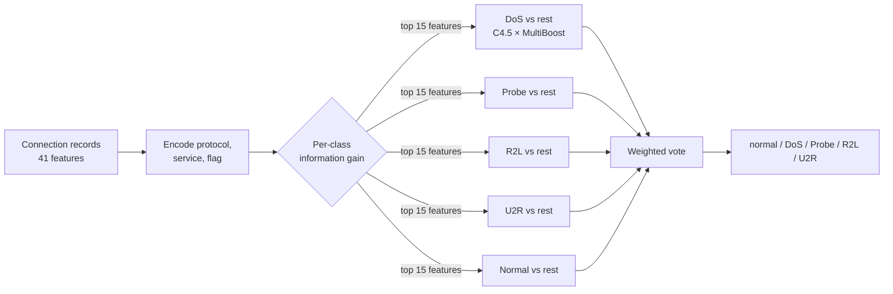
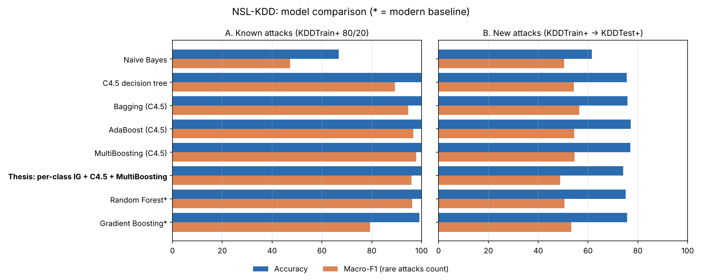

# ML Network Intrusion Detection — C4.5 + MultiBoosting

My M.Tech thesis (Osmania University, 2010–11), rebuilt in Python with a full model comparison.

The original system, written in Java with **Weka**, classified network connections as normal traffic or one of four
attack families (DoS, Probe, R2L, U2R). It reached a **93.81% detection rate on KDD Cup 99**, beating standalone
AdaBoost and bagging. This repository re-implements that pipeline from the paper, including MultiBoosting from
scratch, and compares it with classic and modern models on **NSL-KDD**, the cleaned successor to KDD Cup 99.

📄 [Thesis summary](docs/thesis.md) · 📊 [Full results](results/RESULTS.md)

> **Note:** this is a 2026 reproduction from the paper, not the original 2011 Weka code. Numbers differ from the
> thesis because the dataset (NSL-KDD vs KDD Cup 99), library (scikit-learn vs Weka) and splits are different.
> `weka/run_weka.sh` re-runs the original Weka setup (J48 + MultiBoostAB) if you want the Java version.

## Pipeline



1. **Feature selection.** Rank the 41 features by information gain separately for each class, so rare attacks
   (U2R, R2L) get the features that matter to them.
2. **Binary C4.5 trees.** Train one "this class vs the rest" decision tree per class.
3. **MultiBoosting** ([Webb, 2000](https://link.springer.com/article/10.1023/A:1007659514849)). AdaBoost plus wagging:
   boosting rounds are grouped into ~√T sub-committees, and weights are reset to random Poisson weights at each
   boundary. This cuts both bias and variance. The implementation is in [`src/nids/multiboost.py`](src/nids/multiboost.py).

## Results

Eight models, two tests (20 boosting/bagging rounds, seed 42):

- **A. Known attacks:** 80/20 split of KDDTrain+. Train and test contain the same attack types, as in the thesis.
- **B. New attacks:** train on KDDTrain+, test on KDDTest+, which contains 17 attack types the models never saw.

| Model | A: Accuracy | A: Macro-F1 | B: Accuracy | B: Detection rate | B: False alarms |
|---|---|---|---|---|---|
| Naive Bayes | 66.80% | 0.473 | 61.54% | 94.39% | 44.28% |
| C4.5 decision tree | 99.79% | 0.893 | 75.57% | 65.02% | 3.09% |
| Bagging (C4.5) | 99.81% | 0.946 | 75.87% | 63.07% | 2.97% |
| AdaBoost (C4.5) | 99.90% | 0.967 | **77.19%** | 64.87% | 2.97% |
| **MultiBoosting (C4.5)** | **99.92%** | **0.978** | 77.03% | 64.16% | 2.99% |
| Thesis: per-class IG + C4.5 + MultiBoosting | 99.90% | 0.959 | 74.06% | 59.04% | 2.95% |
| Random Forest | 99.88% | 0.963 | 75.10% | 59.98% | 2.65% |
| Gradient Boosting (HistGB) | 99.15% | 0.794 | 75.76% | 65.65% | 3.47% |



### What the comparison shows

- **The thesis claim holds on known attacks.** MultiBoosting with C4.5 has the best accuracy (99.92%), detection
  rate (99.89%) and macro-F1 (0.978) of the eight models. It beats AdaBoost (0.967) and bagging (0.946), and also
  beats Random Forest and gradient boosting.
- **Macro-F1 separates the models; accuracy doesn't.** Every tree ensemble scores above 99.8% accuracy because
  DoS and normal traffic dominate. The real differences are on rare attacks (R2L, U2R), which is why the thesis
  focused on them.
- **New attack types are the hard problem.** On KDDTest+ every model falls to 74–77% accuracy and about 60–66%
  detection, and R2L/U2R are mostly missed. A model that scores 99% on attacks it has seen can miss a third of new
  ones. That is the case for continuous evaluation, fresh labelled data and retraining, rather than one-time
  training.
- **Per-class feature selection didn't add accuracy here.** On NSL-KDD, the per-class information-gain version
  matches plain MultiBoosting on known attacks and trails it on new ones; 15 features per class may be too few
  once attacks change. Its benefit is interpretability: you can see which features drive each attack family
  ([table](results/RESULTS.md#features-chosen-by-information-gain-thesis-step-1)).

## Run it

```bash
git clone https://github.com/ravikv08/nids-thesis.git && cd nids-thesis
pip install -r requirements.txt
python run_experiments.py          # downloads NSL-KDD (~20 MB), trains 8 models x 2 tests (~5 min on a laptop)
python make_report.py              # writes results/RESULTS.md and the charts
pytest -q                          # unit tests
```

Options: `--estimators 50` for more boosting rounds, `--quick` for a 1-minute smoke test on 20% of the data.

## Repository layout

```
src/nids/
  data.py         NSL-KDD download, 41 features, attack -> family mapping (DoS, Probe, R2L, U2R)
  features.py     encoding + per-class information-gain feature selection
  multiboost.py   MultiBoosting (Webb 2000), scikit-learn compatible
  models.py       the thesis model + 7 comparison models
  evaluate.py     detection rate, false alarm rate, macro-F1, per-class recall
run_experiments.py, make_report.py
results/          metrics.csv, RESULTS.md, charts, confusion matrices
weka/             ARFF export + Weka command line (J48, AdaBoostM1, Bagging, MultiBoostAB)
docs/thesis.md    summary of the original thesis
tests/            unit tests (run in GitHub Actions)
```

## Data

[NSL-KDD](https://www.unb.ca/cic/datasets/nsl.html) (Tavallaee et al., 2009) removes the duplicate records that
inflate KDD Cup 99 scores ([Brugger, 2007](https://www.kdnuggets.com/news/2007/n18/4i.html), cited in the thesis).
The files are downloaded at run time from a public GitHub mirror and are not stored in this repository.

## Author

**Ravi Kumar**: Data & AI architect. [LinkedIn](https://www.linkedin.com/in/ravi-k-aaa86a28) · [GitHub](https://github.com/ravikv08)
Thesis advisor: M. Swamy Das, Associate Professor, Dept. of CSE, Osmania University.
