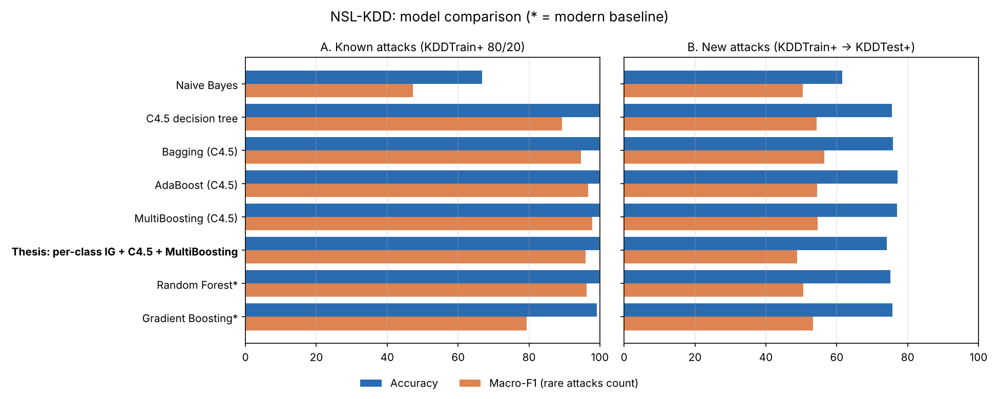
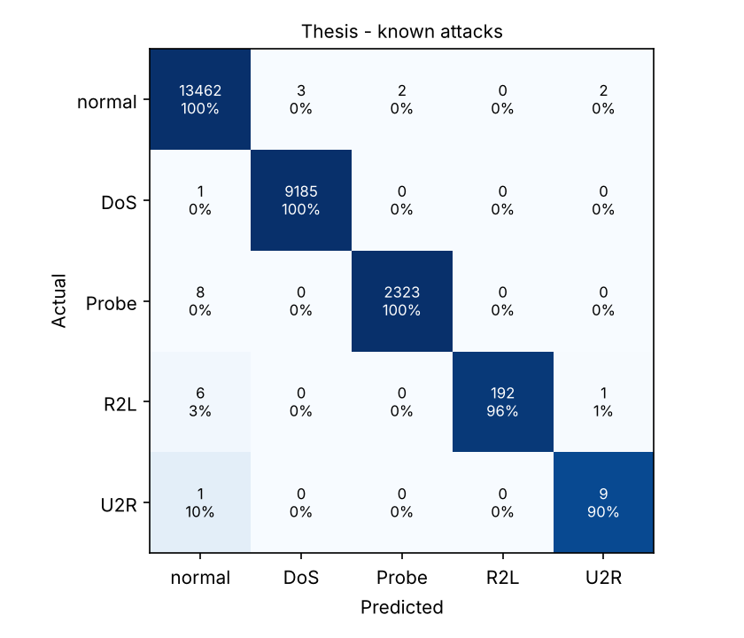
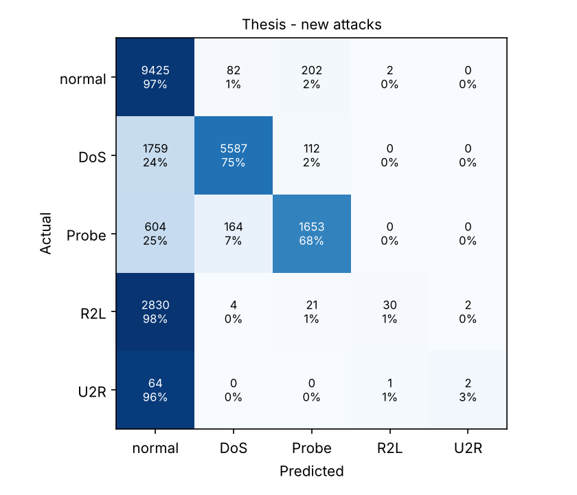

# Results

NSL-KDD, 20 boosting/bagging rounds, seed 42. Best value per column in **bold**.

## A. Known attacks (KDDTrain+ 80/20)

| Model | Accuracy | Detection rate | False alarms | Macro-F1 | DoS | Probe | R2L | U2R | Train (s) |
|---|---|---|---|---|---|---|---|---|---|
| Naive Bayes (classic baseline) | 66.80% | 99.57% | 57.26% | 0.473 | 94.73% | 97.51% | 45.23% | 90.00% | 0 |
| C4.5 decision tree | 99.79% | 99.77% | 0.15% | 0.893 | 99.93% | 99.57% | 92.96% | 60.00% | 1 |
| Bagging (C4.5) | 99.81% | 99.73% | 0.10% | 0.946 | 99.97% | 99.36% | 93.47% | 70.00% | 5 |
| AdaBoost (C4.5) | 99.90% | 99.85% | 0.05% | 0.967 | 99.95% | 99.70% | 96.98% | 90.00% | 13 |
| MultiBoosting (C4.5) | **99.92%** | **99.89%** | 0.05% | **0.978** | 99.98% | 99.70% | 97.99% | 100.00% | 12 |
| Thesis: per-class IG + C4.5 + MultiBoosting | 99.90% | 99.86% | 0.05% | 0.959 | 99.99% | 99.66% | 96.48% | 90.00% | 47 |
| Random Forest (modern baseline) | 99.88% | 99.83% | 0.07% | 0.963 | 99.99% | 99.57% | 96.48% | 80.00% | 4 |
| Gradient Boosting (modern baseline) | 99.15% | 99.75% | 0.61% | 0.794 | 99.09% | 98.63% | 94.47% | 60.00% | 3 |

## B. New attacks (KDDTrain+ -> KDDTest+)

| Model | Accuracy | Detection rate | False alarms | Macro-F1 | DoS | Probe | R2L | U2R | Train (s) |
|---|---|---|---|---|---|---|---|---|---|
| Naive Bayes (classic baseline) | 61.54% | **94.39%** | 44.28% | 0.504 | 69.04% | 96.53% | 32.32% | 65.67% | 0 |
| C4.5 decision tree | 75.57% | 65.02% | 3.09% | 0.543 | 76.55% | 67.95% | 9.08% | 14.93% | 1 |
| Bagging (C4.5) | 75.87% | 63.07% | 2.97% | **0.565** | 76.13% | 65.14% | 14.44% | 13.43% | 5 |
| AdaBoost (C4.5) | **77.19%** | 64.87% | 2.97% | 0.545 | 81.17% | 71.09% | 6.82% | 8.96% | 17 |
| MultiBoosting (C4.5) | 77.03% | 64.16% | 2.99% | 0.545 | 79.82% | 72.70% | 7.86% | 7.46% | 18 |
| Thesis: per-class IG + C4.5 + MultiBoosting | 74.06% | 59.04% | 2.95% | 0.488 | 74.91% | 68.28% | 1.04% | 2.99% | 54 |
| Random Forest (modern baseline) | 75.10% | 59.98% | 2.65% | 0.506 | 76.84% | 66.54% | 4.61% | 2.99% | 6 |
| Gradient Boosting (modern baseline) | 75.76% | 65.65% | 3.47% | 0.534 | 79.73% | 56.38% | 12.68% | 41.79% | 1 |

| Thesis model, known attacks | Thesis model, new attacks |
|---|---|
|  |  |

## Features chosen by information gain (thesis step 1)

Top 8 of the 15 features kept for each one-vs-rest classifier:

| Class | Top features (information gain) |
|---|---|
| DoS | `src_bytes` (0.477), `diff_srv_rate` (0.465), `flag` (0.428), `same_srv_rate` (0.415), `service` (0.384), `dst_host_serror_rate` (0.374), `count` (0.371), `dst_host_diff_srv_rate` (0.365) |
| Probe | `src_bytes` (0.169), `service` (0.142), `dst_host_diff_srv_rate` (0.110), `dst_host_srv_diff_host_rate` (0.091), `dst_host_same_src_port_rate` (0.087), `dst_host_srv_count` (0.085), `flag` (0.071), `diff_srv_rate` (0.063) |
| R2L | `src_bytes` (0.089), `service` (0.060), `dst_bytes` (0.040), `hot` (0.034), `count` (0.028), `srv_count` (0.027), `dst_host_srv_diff_host_rate` (0.026), `dst_host_srv_count` (0.024) |
| U2R | `dst_host_count` (0.007), `same_srv_rate` (0.006), `logged_in` (0.005), `dst_host_srv_count` (0.004), `service` (0.004), `duration` (0.004), `root_shell` (0.003), `dst_host_same_srv_rate` (0.003) |
| normal | `src_bytes` (0.555), `service` (0.456), `dst_bytes` (0.435), `diff_srv_rate` (0.342), `flag` (0.337), `same_srv_rate` (0.337), `dst_host_srv_count` (0.329), `dst_host_same_srv_rate` (0.285) |
